# Traxxas 6873T wheel and Roboracer car parts

Visual models for the Roboracer / F1TENTH 1/10-scale car model used with ROS 2:

- the **Traxxas 6873T wheel** and tyre, sized like the stock Traxxas Slash tyre, in left (`_L`) and right (`_R`) versions;
- the **car body**, split into a **frame** and a **front axle module** so that the URDF can set the wheelbase as a parameter;
- a **car assembly**, used only for rendering, that links the parts and the wheels.

All models use metres, with +Z up.

## Models

| Model | Source | Origin and axes | Contents |
|---|---|---|---|
| Wheel L / R | `blender/traxxas_6873T_wheel.blend` | Hub centre; wheel axis along X | Tyre (0.1095 m diameter, about 0.039 m wide) and rim with open spokes |
| Frame | `blender/roboracer_frame.blend` | Rear axle centre, at wheel-centre height; x forward, y left | Chassis plate up to the cut, rear suspension and shocks, nerf bars, tubular rear bumper and triangulated supports |
| Front axle module | `blender/roboracer_front_axle.blend` | Front axle centre, at wheel-centre height; x forward, y left | Front bulkhead and gearbox, front plate section, skid ramp, front suspension and shocks, rubber bumper |
| Center-of-mass marker | `blender/roboracer_center_of_mass.blend` | Sphere centre; x forward, y left | 0.100 m diameter sphere with a metallic-red/translucent-light-gray checkerboard |

- The frame and front axle module meet at a cut 0.272 m ahead of the frame origin, which is 0.052 m behind the front axle origin. That puts the nominal **wheelbase at 0.324 m**.
- Wheel centres sit at y = ±0.145 (**track 0.290 m**), 0.055 m above the ground.
- In the car the wheels are rotated about Z: +90° on the left side, −90° on the right, so the hubs face outwards.
- The rear bumper has one shallow face, three lower support triangles and two screw-mounted braces to a raised crossbar. Its top corner span is approximately 0.162 m, estimated from reference photos using the 0.186 m chassis plate width, rather than measured from the physical part.
- The center-of-mass marker is a separate linked part, centred at (0.15532, 0, 0.01434) m relative to the rear-wheel midpoint, or 0.06934 m above the ground. Its 16 × 8 checkerboard uses two face-assigned materials, preserving the red/light-gray pattern in USD/DAE without texture files. Light-gray squares are 25% opaque and non-metallic, with IOR 1 to avoid refraction and better match DAE's diffuse transparency in USD/Omniverse. Red squares remain fully opaque and metallic in Blender/USD; DAE uses diffuse materials. Lighting, tone mapping and transparency support can still differ by viewer.

## Gallery

Each view has a studio backdrop and a MuJoCo-style checker floor with 0.1 m tiles. Each also has a DAE counterpart: the same camera, lights, floor and world, but model geometry and materials read from the actual exported Collada files.

| | Studio (.blend) | Checker (.blend) | Studio (DAE) | Checker (DAE) |
|---|---|---|---|---|
| Car assembly | [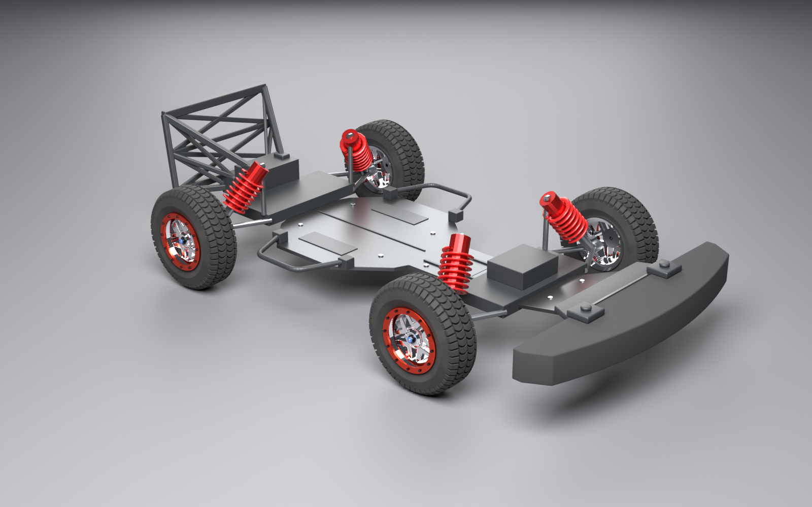](renders/roboracer_car_render.png) | [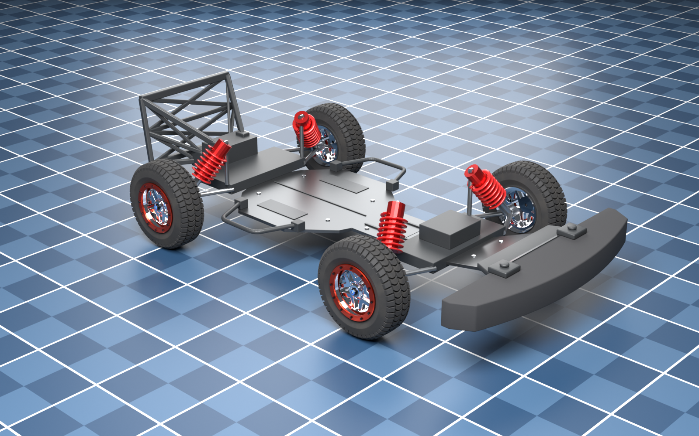](renders/roboracer_car_checker_render.png) | [](renders/roboracer_car_render_dae.png) | [](renders/roboracer_car_checker_render_dae.png) |
| Single wheel | [](renders/traxxas_6873T_render.png) | [](renders/traxxas_6873T_checker_render.png) | [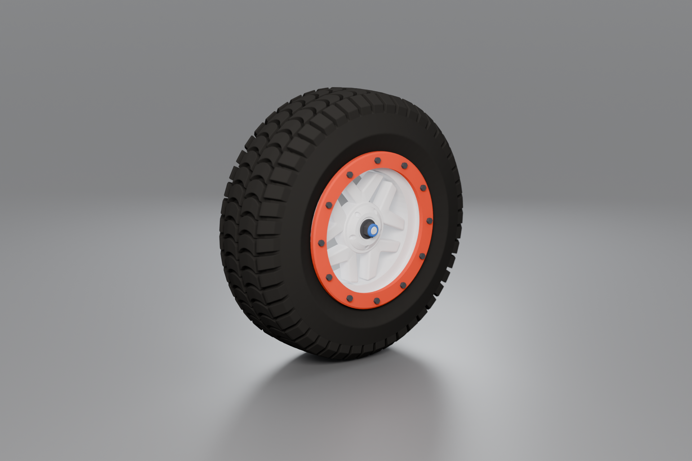](renders/traxxas_6873T_render_dae.png) | [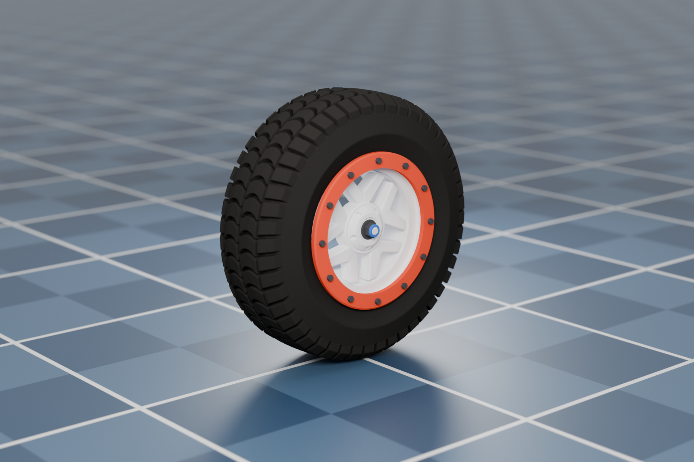](renders/traxxas_6873T_checker_render_dae.png) |
| Wheel stack | [](renders/traxxas_6873T_stack_render.png) | [](renders/traxxas_6873T_stack_checker_render.png) | [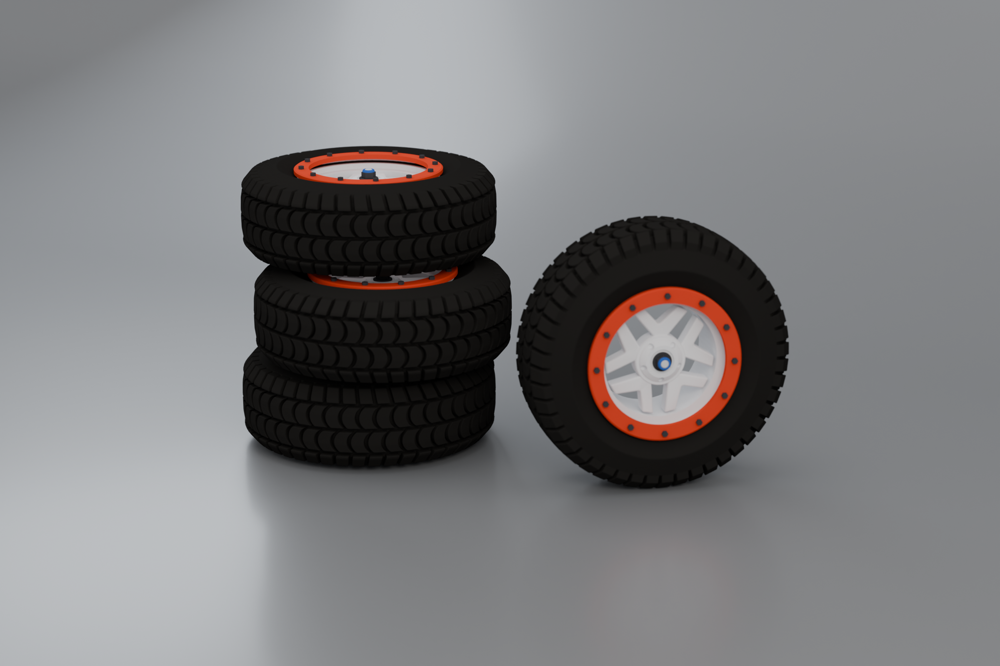](renders/traxxas_6873T_stack_render_dae.png) | [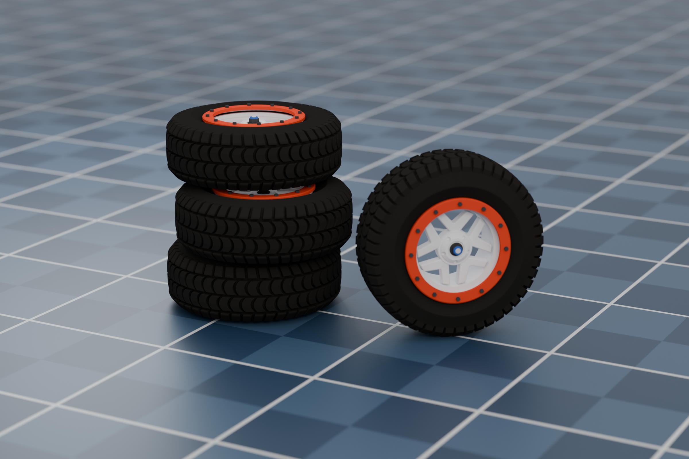](renders/traxxas_6873T_stack_checker_render_dae.png) |
| Frame | [](renders/roboracer_frame_render.png) | [](renders/roboracer_frame_checker_render.png) | [](renders/roboracer_frame_render_dae.png) | [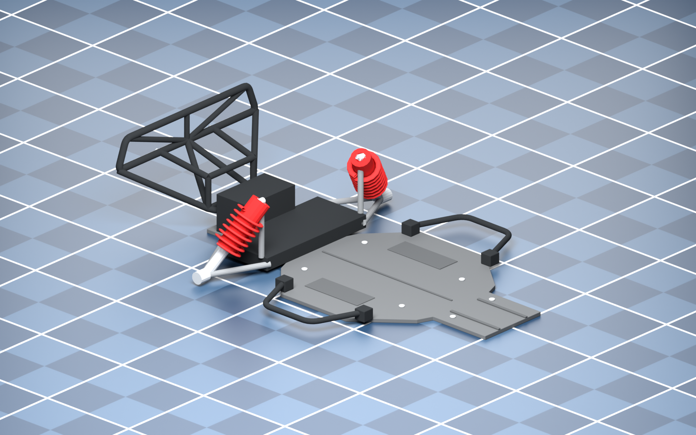](renders/roboracer_frame_checker_render_dae.png) |
| Front axle | [](renders/roboracer_front_axle_render.png) | [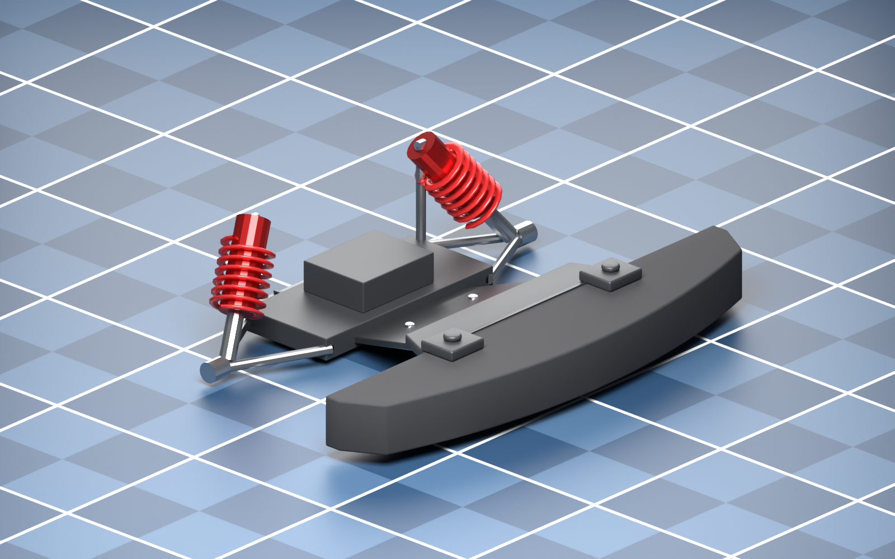](renders/roboracer_front_axle_checker_render.png) | [](renders/roboracer_front_axle_render_dae.png) | [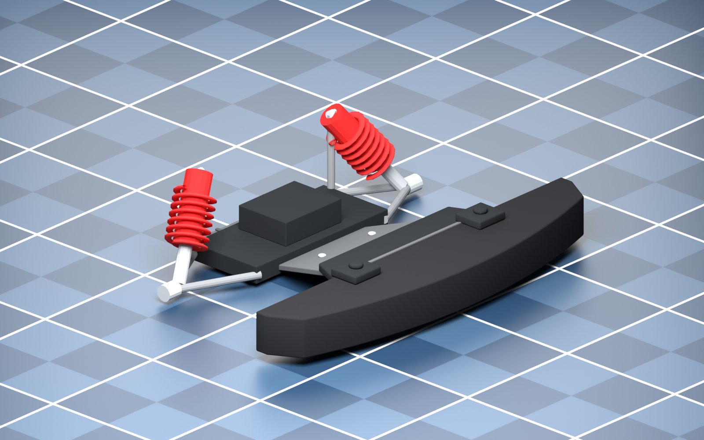](renders/roboracer_front_axle_checker_render_dae.png) |
| Center-of-mass marker | [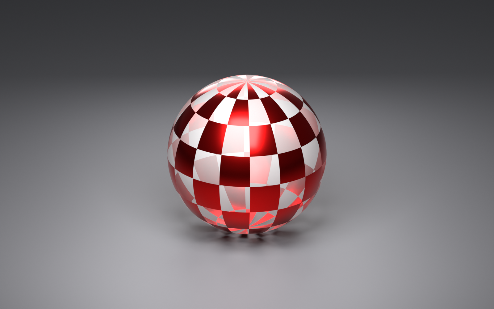](renders/roboracer_center_of_mass_render.png) | [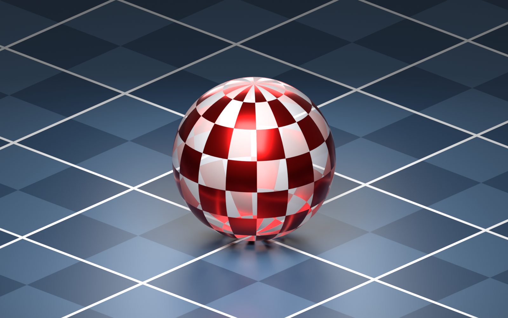](renders/roboracer_center_of_mass_checker_render.png) | [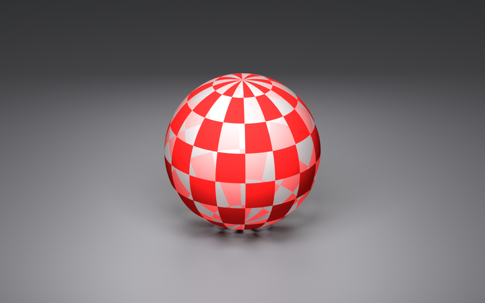](renders/roboracer_center_of_mass_render_dae.png) | [](renders/roboracer_center_of_mass_checker_render_dae.png) |

`tools/render.py` renders both backgrounds by default; `--dae` switches the models to their exported counterparts and adds `_dae` to the filenames. Every part of the DAE car is converted, including all four wheels and the center-of-mass marker. The standalone part stages are created in memory; no `.blend` is saved.

These are Blender renders of DAE's exported Lambert materials, not screenshots from Isaac Sim, RViz or Gazebo. Procedural shading and PBR metallic reflections are absent in DAE; transparency and lighting can still differ by viewer. See [AGENTS.md](AGENTS.md#rendering) for setup and commands.

## Layout

| Folder | Contents |
|---|---|
| [`blender/`](blender/) | `traxxas_6873T_wheel.blend`, `roboracer_frame.blend`, `roboracer_front_axle.blend` and `roboracer_center_of_mass.blend`, **the sources of truth**. `roboracer_car.blend` is the assembly: it only links the other files and holds the car render scene. The wheel file also holds the two wheel render scenes. |
| [`usd/`](usd/) | One `.usdc` per wheel side and per car part, exported from the `.blend` files. **Never edit these by hand.** |
| [`dae/`](dae/) | The same models as Collada (e.g. for URDF, RViz or Gazebo), exported from the `.usdc` files. **Never edit these by hand.** |
| [`renders/`](renders/) | Native Blender and exported-DAE reference images. |
| [`tools/`](tools/) | Python export and render scripts, the `export_all.sh` wrapper, and the Dockerfile in `tools/docker/`. |
| `build/` | Scratch output, such as test renders. Ignored by git. |

## Car assembly parameters

The root empty `Roboracer_Car` in `roboracer_car.blend` sits at the rear axle centre and has two custom properties:

- `wheelbase` (default 0.324 m) moves the front axle module and the front wheels;
- `track` (default 0.290 m) moves every wheel to y = ±track/2.

The drivers use simple expressions, so they work without enabling Python auto-run. Changing the wheelbase opens a gap, or an overlap, in the chassis plate at the cut. That is expected, and the URDF will behave the same way.

## Quick start

These commands need Blender 5.3.x. The `.dae` export also needs Docker.

```bash
# Regenerate usd/ and dae/ after changing a source .blend
BLENDER=/path/to/blender-5.3.x/blender tools/export_all.sh

# Render the reference scenes into build/renders/
/path/to/blender-5.3.x/blender -b blender/roboracer_car.blend --python tools/render.py
/path/to/blender-5.3.x/blender -b blender/traxxas_6873T_wheel.blend --python tools/render.py

# Standalone parts (also creates studio/checker views in memory)
/path/to/blender-5.3.x/blender -b blender/roboracer_frame.blend --python tools/render.py
/path/to/blender-5.3.x/blender -b blender/roboracer_front_axle.blend --python tools/render.py
/path/to/blender-5.3.x/blender -b blender/roboracer_center_of_mass.blend --python tools/render.py

# DAE counterparts; install the optional reader first (see AGENTS.md)
/path/to/blender-5.3.x/blender -b blender/roboracer_car.blend --python tools/render.py -- --dae
```

See [AGENTS.md](AGENTS.md) for the full procedures and rules. They apply to both people and AI agents.

## License

Licensed under the [Apache License, Version 2.0](LICENSE). This covers the models, exports, renders, scripts and documentation in this repository.

"Traxxas" and "Slash" are trademarks of Traxxas, L.P. The models are independent recreations, and the license grants no rights to those trademarks. See section 6 of the license.
