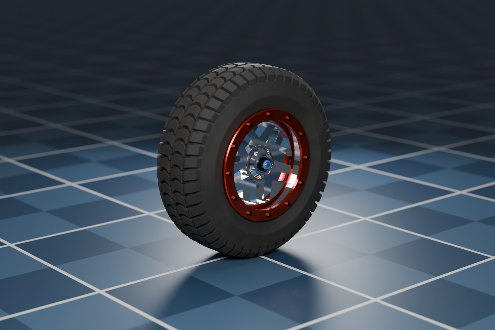

# Traxxas 6873T wheel and Roboracer car parts

Visual models for the Roboracer / F1TENTH 1/10-scale car model used with ROS 2:

- the **Traxxas 6873T wheel** and tyre, sized like the stock Traxxas Slash tyre, in left (`_L`) and right (`_R`) versions;
- the **car body**, split into a **frame** and a **front axle module** so that the URDF can set the wheelbase as a parameter;
- a **car assembly**, used only for rendering, that links the parts and the wheels.

All models use metres, with +Z up.

## Models

| Model | Source | Origin and axes | Contents |
|---|---|---|---|
| Wheel L / R | `blender/traxxas_6873T_wheel.blend` | Hub centre; wheel axis along X | Tyre (0.1095 m diameter, about 0.039 m wide) and rim with open spokes |
| Frame | `blender/roboracer_frame.blend` | Rear axle centre, at wheel-centre height; x forward, y left | Chassis plate up to the cut, rear suspension and shocks, nerf bars, rear bumper truss |
| Front axle module | `blender/roboracer_front_axle.blend` | Front axle centre, at wheel-centre height; x forward, y left | Front bulkhead and gearbox, front plate section, skid ramp, front suspension and shocks, rubber bumper |

- The frame and front axle module meet at a cut 0.272 m ahead of the frame origin, which is 0.052 m behind the front axle origin. That puts the nominal **wheelbase at 0.324 m**.
- Wheel centres sit at y = ±0.145 (**track 0.290 m**), 0.055 m above the ground.
- In the car the wheels are rotated about Z: +90° on the left side, −90° on the right, so the hubs face outwards.

## Gallery

Each render scene comes in two versions: a studio backdrop, and a MuJoCo-style checker floor with 0.1 m tiles that also works as a scale reference.

| | Studio | MuJoCo-style checker |
|---|---|---|
| Car assembly | [](renders/roboracer_car_render.png) | [](renders/roboracer_car_checker_render.png) |
| Single wheel | [](renders/traxxas_6873T_render.png) | [](renders/traxxas_6873T_checker_render.png) |
| Wheel stack | [](renders/traxxas_6873T_stack_render.png) | [](renders/traxxas_6873T_stack_checker_render.png) |

All images are rendered with `tools/render.py`, which renders both versions by default. See [AGENTS.md](AGENTS.md#rendering).

## Layout

| Folder | Contents |
|---|---|
| [`blender/`](blender/) | `traxxas_6873T_wheel.blend`, `roboracer_frame.blend` and `roboracer_front_axle.blend`, **the sources of truth**. `roboracer_car.blend` is the assembly: it only links the other files and holds the car render scene. The wheel file also holds the two wheel render scenes. |
| [`usd/`](usd/) | One `.usdc` per wheel side and per car part, exported from the `.blend` files. **Never edit these by hand.** |
| [`dae/`](dae/) | The same models as Collada (e.g. for URDF, RViz or Gazebo), exported from the `.usdc` files. **Never edit these by hand.** |
| [`renders/`](renders/) | Reference images rendered from the `.blend` files. |
| [`tools/`](tools/) | Python export and render scripts, the `export_all.sh` wrapper, and the Dockerfile in `tools/docker/`. |
| `build/` | Scratch output, such as test renders. Ignored by git. |

## Car assembly parameters

The root empty `Roboracer_Car` in `roboracer_car.blend` sits at the rear axle centre and has two custom properties:

- `wheelbase` (default 0.324 m) moves the front axle module and the front wheels;
- `track` (default 0.290 m) moves every wheel to y = ±track/2.

The drivers use simple expressions, so they work without enabling Python auto-run. Changing the wheelbase opens a gap, or an overlap, in the chassis plate at the cut. That is expected, and the URDF will behave the same way.

## Quick start

These commands need Blender 5.3.x. The `.dae` export also needs Docker.

```bash
# Regenerate usd/ and dae/ after changing a source .blend
BLENDER=/path/to/blender-5.3.x/blender tools/export_all.sh

# Render the reference scenes into build/renders/
/path/to/blender-5.3.x/blender -b blender/roboracer_car.blend --python tools/render.py
/path/to/blender-5.3.x/blender -b blender/traxxas_6873T_wheel.blend --python tools/render.py
```

See [AGENTS.md](AGENTS.md) for the full procedures and rules. They apply to both people and AI agents.

## License

Licensed under the [Apache License, Version 2.0](LICENSE). This covers the models, exports, renders, scripts and documentation in this repository.

"Traxxas" and "Slash" are trademarks of Traxxas, L.P. The models are independent recreations, and the license grants no rights to those trademarks. See section 6 of the license.
